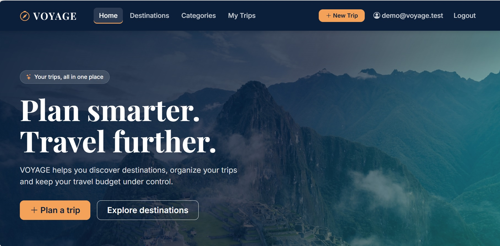
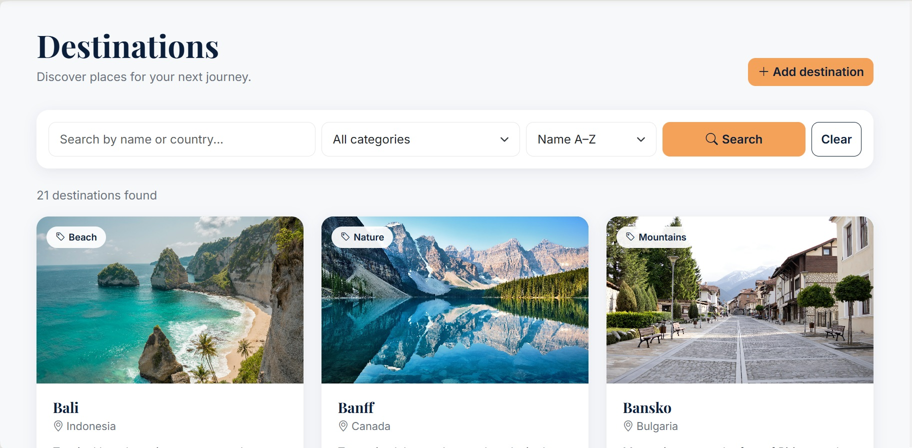
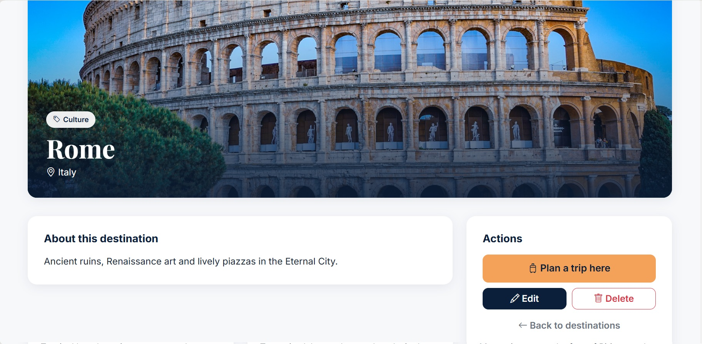
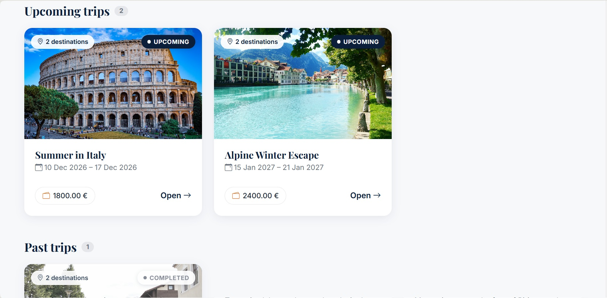
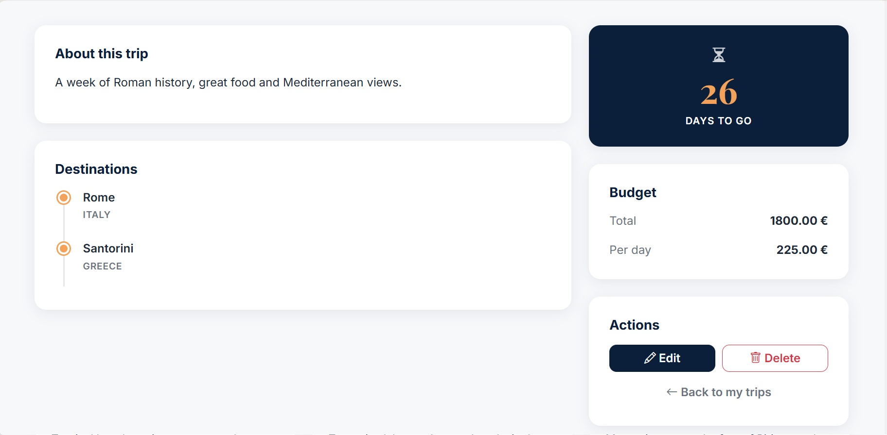
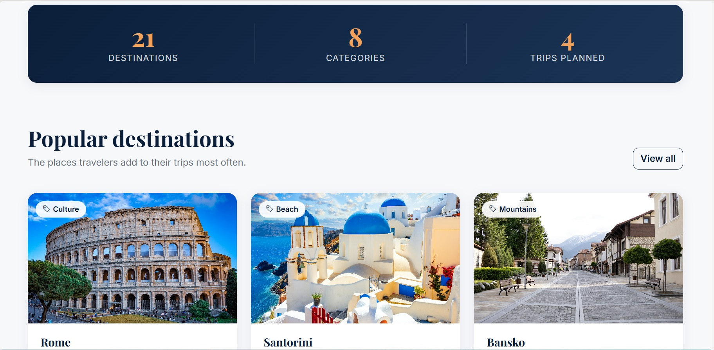
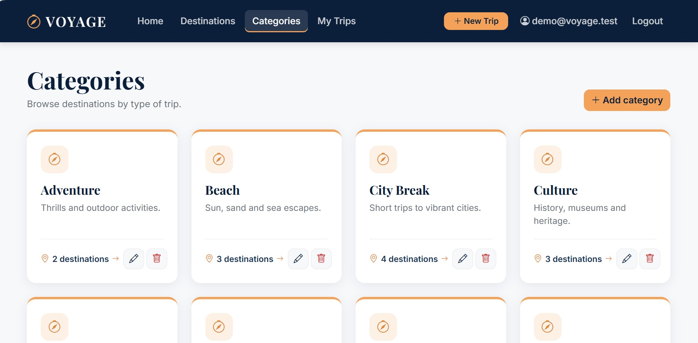
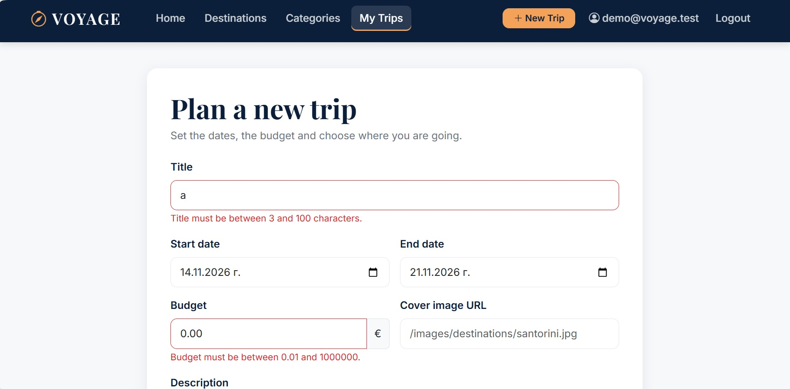
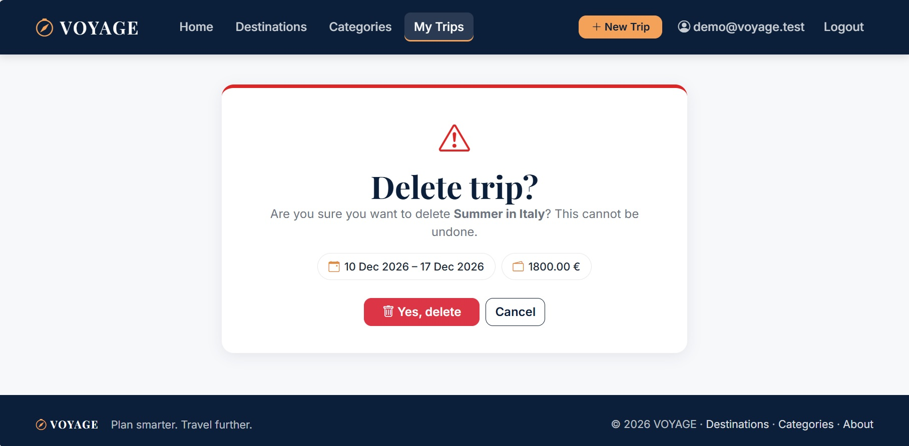
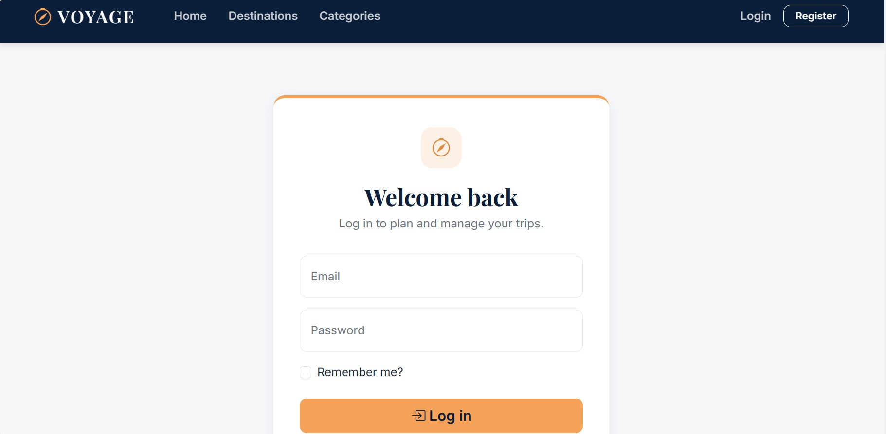

# VOYAGE - ASP.NET Core MVC Travel Planner


VOYAGE is a web application for discovering travel destinations and planning trips in one place.

When people plan a trip, the information is usually spread across notes, browser bookmarks and spreadsheets.
VOYAGE keeps it together. Users browse destinations by category and create their own trips with dates,
a budget and the places they want to visit. Each trip shows its status, how many days are left until it
starts and the budget per day.

The application is made for travelers who want a simple way to find ideas for their next trip and keep
their upcoming and past trips organized.



## Screenshots

<table>
  <tr>
    <td width="50%"><br /><sub>Destinations: search, filter, sort and pagination</sub></td>
    <td width="50%"><br /><sub>Destination details and similar destinations</sub></td>
  </tr>
  <tr>
    <td width="50%"><br /><sub>My Trips: upcoming and past trips</sub></td>
    <td width="50%"><br /><sub>Trip details: countdown, budget and destinations</sub></td>
  </tr>
  <tr>
    <td width="50%"><br /><sub>Home: statistics and popular destinations</sub></td>
    <td width="50%"><br /><sub>Categories</sub></td>
  </tr>
  <tr>
    <td width="50%"><br /><sub>Validation messages</sub></td>
    <td width="50%"><br /><sub>Delete confirmation</sub></td>
  </tr>
</table>

<p align="center">
  <br />
  <sub>Login page</sub>
</p>

## Features

### Destinations
- 20 seeded destinations with image, country, description and category
- Search by name or country
- Filter by category
- Sort by name (A-Z, Z-A) or by popularity (how many trips include the destination)
- Pagination with 12 destinations per page. The search text, category and sorting are kept when you change the page
- Details page with up to 3 similar destinations from the same category
- "Plan a trip here" button that opens the new trip form with this destination already selected
- Add, edit and delete destinations
- Deleting a destination is a soft delete: it is hidden from the site, but trips that already include it still work

### Categories
- 8 seeded categories: Beach, Mountains, City Break, Culture, Nature, Adventure, Wellness and Winter
- Add, edit and delete categories
- Each category shows how many destinations it has. Clicking the number opens the destinations list filtered by that category
- A category cannot be deleted while it still has active destinations

### Trips
- Create, view, edit and delete your own trips
- A trip has a title, start and end date, budget, description, cover image and one or more destinations
- If no cover image is set, the image of the first destination is used
- The status is calculated from the dates:
  - Upcoming: the trip has not started yet
  - Ongoing: today is between the start and end date
  - Completed: the end date has passed
- My Trips is split into upcoming trips and past trips
- The details page shows a countdown that changes with the status, for example "26 days to go", "Day 2 of 5" or "Ended 3 days ago"
- Budget per day is calculated from the total budget and the number of days

### Home page
- Statistics: number of destinations, categories and planned trips
- The 3 most popular destinations, based on how many trips include them

### Other
- About page with information about the project
- Custom 404 and 500 error pages
- Success messages after create, edit and delete
- Confirmation page before every delete
- Responsive layout for desktop, tablet and phone

## User Roles

Guests can:
- browse, search, filter and sort destinations
- open destination details
- view categories

Registered users can also:
- add, edit and delete destinations and categories
- create trips
- view, edit and delete their own trips

Each user sees only their own trips. If someone tries to open another user's trip by changing the id in the
address bar, the application returns 404.

If a guest opens a page that requires login, they are redirected to the login page and after logging in they
are sent back to the page they wanted.

## Validation Rules

Category:
- Name: required, 2 to 50 characters, must be unique
- Description: up to 500 characters

Destination:
- Name: required, 2 to 100 characters
- Country: required, 2 to 60 characters
- Description: required, 10 to 2000 characters
- Image URL: a full link (https://...) or a path starting with /images/
- Category: required, must exist
- The same destination name cannot be added twice in the same country

Trip:
- Title: required, 3 to 100 characters
- Budget: between 0.01 and 1 000 000
- Start date: cannot be in the past
- End date: cannot be before the start date
- Length: up to 365 days
- Destinations: at least one must be selected
- Description: up to 2000 characters

All rules are checked on the server. Most of them are also checked in the browser with jQuery Validation,
so the user sees the error before the form is sent. Empty or invalid numbers and dates show clear messages
instead of the default ASP.NET ones.

## Technologies

Backend:
- ASP.NET Core MVC on .NET 10, C#
- ASP.NET Core Identity 10.0.15 for register, login and logout

Data:
- Entity Framework Core 10.0.15 (code first, migrations, seed data)
- Microsoft SQL Server LocalDB

Frontend:
- Razor Views
- Bootstrap 5 and Bootstrap Icons
- Custom CSS, Google Fonts (Inter and Playfair Display)

Validation:
- Data Annotations and `IValidatableObject` on the server
- jQuery Validation in the browser

Tools:
- Visual Studio 2026, Git and GitHub

## Architecture

The application uses the MVC pattern with a service layer:

1. The controller receives the request and checks the model state
2. The controller calls a service through its interface
3. The service works with the database through `ApplicationDbContext` and returns a view model
4. The controller passes the view model to the Razor view

Controllers do not contain business logic and entities are never passed directly to the views.
All services are registered in `Program.cs` with dependency injection (`AddScoped`).

Folders in Voyage.Web:
- Controllers: Home, Destinations, Categories and Trips. They inherit `BaseController`, which gets the id of the logged-in user
- Services: DestinationService, CategoryService, TripService and HomeService, each with an interface in `Services/Contracts`
- Data: `ApplicationDbContext`, the entities, Fluent API configurations with the seed data, and the migrations
- ViewModels: view models grouped by feature
- Views: Razor views and shared partial views (destination card, trip card, empty state, messages)
- Common: constants for validation and paging, error and success messages, and the enums `TripStatus` and `DestinationSorting`
- Areas/Identity: the login and register pages, scaffolded and styled to match the site
- wwwroot: CSS, JavaScript and the destination images

## Database

Entities:
- Category: name and description
- Destination: name, country, description, image URL, category and `IsDeleted`
- Trip: title, description, start date, end date, budget, cover image URL, owner (user id) and creation date
- TripDestination: connects trips and destinations (many-to-many, composite primary key)

Relations:
- one category has many destinations
- one user has many trips
- trips and destinations are connected many-to-many through TripDestination

Rules in the database:
- unique index on the category name
- check constraints: the end date cannot be before the start date and the budget must be greater than 0
- a category cannot be deleted while destinations reference it (Restrict delete behavior)
- a global query filter hides deleted destinations from all queries

The seed data (8 categories and 20 destinations) is added with the migrations, so the site has content right
after the database is created.

## Security

- `[Authorize]` on every action that creates, edits or deletes data
- Ownership check on every trip action (details, edit and delete)
- `[ValidateAntiForgeryToken]` on every POST action
- Wrong ids, missing ids and invalid page numbers return 404 or are handled without errors
- Passwords are handled by ASP.NET Core Identity

## How to Run

Requirements:
- [.NET 10 SDK](https://dotnet.microsoft.com/download)
- SQL Server LocalDB (comes with Visual Studio)
- Visual Studio 2026 or the .NET CLI

1. Clone the repository:
```bash
git clone https://github.com/samirbeki/Voyage.git
cd Voyage
```

2. The connection string in `Voyage.Web/appsettings.json` uses LocalDB and works without changes:
```json
"ConnectionStrings": {
  "DefaultConnection": "Server=(localdb)\\mssqllocaldb;Database=aspnet-Voyage.Web-6fd6618c-a292-47e9-b8ac-a2642d993f0c;Trusted_Connection=True;MultipleActiveResultSets=true;Connect Timeout=60"
}
```

3. Create the database. In Visual Studio open `Voyage.slnx` and run in Package Manager Console:
```powershell
Update-Database
```
Or with the .NET CLI:
```bash
dotnet restore
dotnet tool install --global dotnet-ef
dotnet ef database update --project Voyage.Web
```
Visual Studio restores the NuGet packages automatically when the solution is opened.

4. Start the application with F5 in Visual Studio, or:
```bash
dotnet run --project Voyage.Web
```

5. Register a new account. The password needs at least one uppercase letter, one digit and one symbol.

### If something does not work

- "Cannot open database" or a timeout on the first start: LocalDB may need a few seconds to start. Run
  `sqllocaldb start mssqllocaldb` in a terminal and start the application again.
- "Invalid object name" errors: the database was not created. Run `Update-Database` (step 3).
- `dotnet ef` is not found: install it with `dotnet tool install --global dotnet-ef`.

## Quick Tour

After you register, you can try the main features in a few minutes:

1. Open Destinations, search for a country, choose a category and change the sorting
2. Open a destination and click "Plan a trip here"
3. Fill in the trip and save it. Try a budget of 0 or an end date before the start date to see the validation
4. Open My Trips and then the trip details to see the status, the countdown and the budget per day
5. Go back to the Home page and check the statistics and the popular destinations
6. Open Categories and click the number of destinations of a category

## Main Pages

- `/` : Home page with statistics and popular destinations
- `/Destinations` : all destinations with search, filter, sorting and pagination
- `/Destinations/Details/{id}` : destination details and similar destinations
- `/Destinations/Add` : add a destination (login required)
- `/Categories` : all categories
- `/Categories/Add` : add a category (login required)
- `/Trips` : My Trips (login required)
- `/Trips/Create` : plan a new trip (login required)
- `/Trips/Details/{id}` : trip details (owner only)
- `/Home/About` : About page
- `/Identity/Account/Login` and `/Identity/Account/Register` : login and register

## Future Improvements

Features planned for the next version:

- Admin role, so only administrators can manage destinations and categories
- Trip expenses and how much of the budget is left
- Day-by-day plan for each trip
- Reviews and ratings for destinations
- Favorite destinations
- Packing list for each trip
- Export a trip to a calendar (.ics file)
- Splitting the solution into several projects and adding unit tests

## Author

Mirko Bekirov - [github.com/samirbeki](https://github.com/samirbeki)
